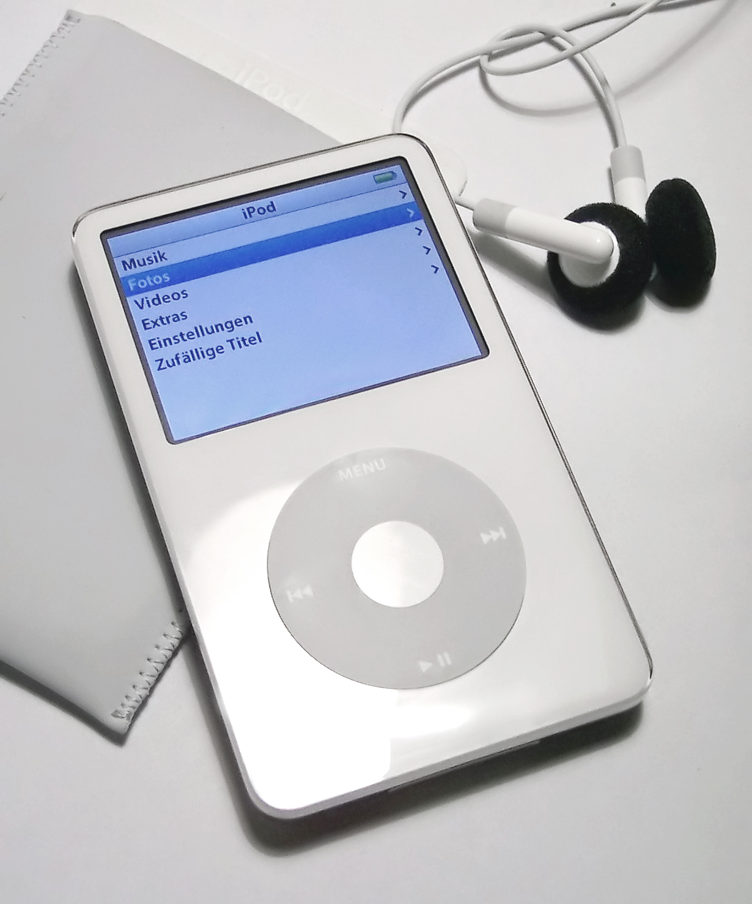

# Project Topic

My project is a **self-owned music platform** where listeners can discover music and create playlists. It’s *personal*—not ~~just another copy~~ of existing services.

- Discover music
- Build personal playlists



> “Music should be easy to discover and enjoy.”

---

# Project Objective

The goal is to make listening and organizing music simple, while learning Markdown with this presentation. See the [Markdown Guide](https://www.markdownguide.org/).

1. Find music to enjoy.
2. Organize it into playlists.

- [ ] Discover tracks
- [ ] Create a playlist

| Feature | Purpose |
|:---|:---|
| Music library | Find tracks |
| Playlists | Organize favorites |

Example setting: `platform`

```json
{
  "platform": "My Music"
}
```
